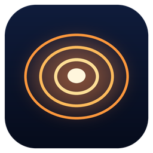
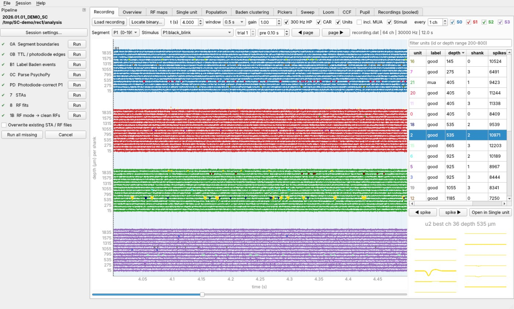
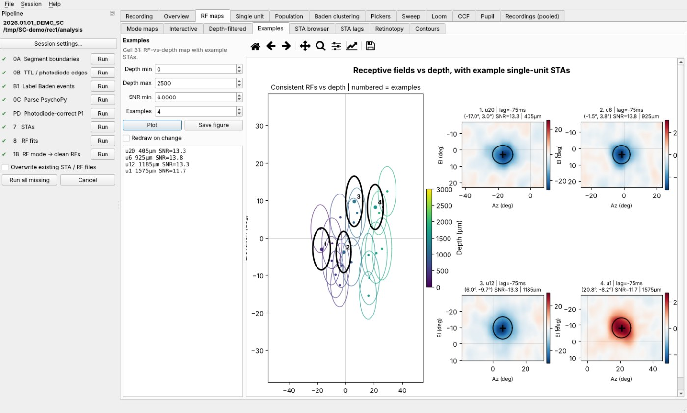
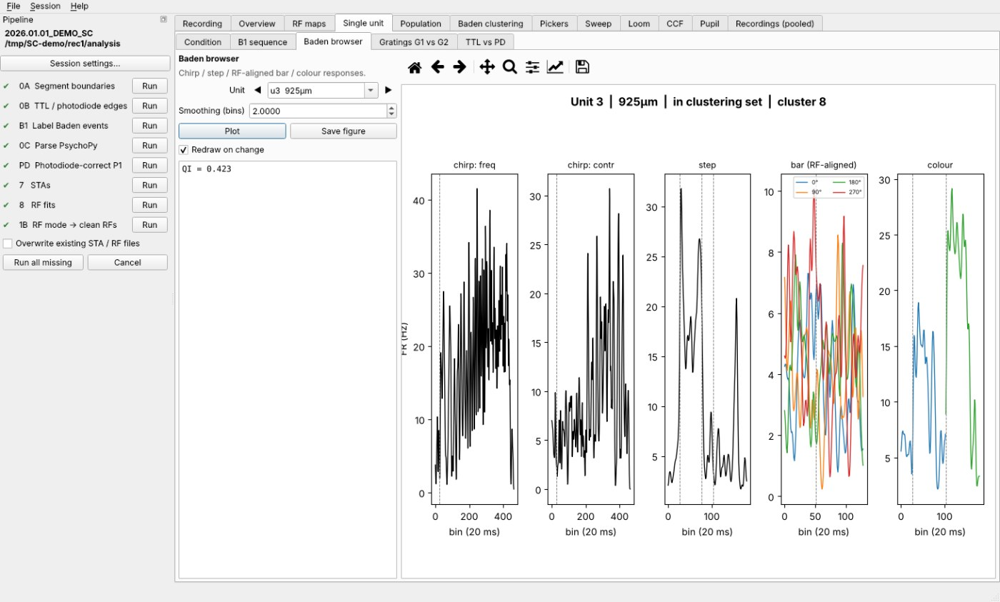
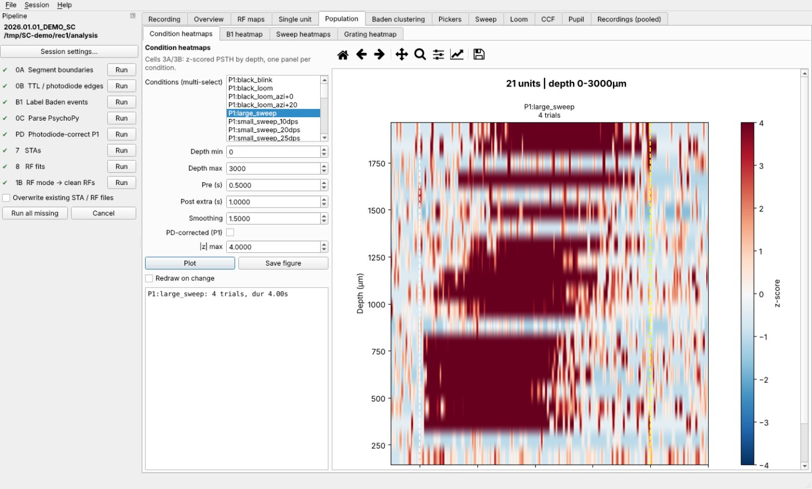
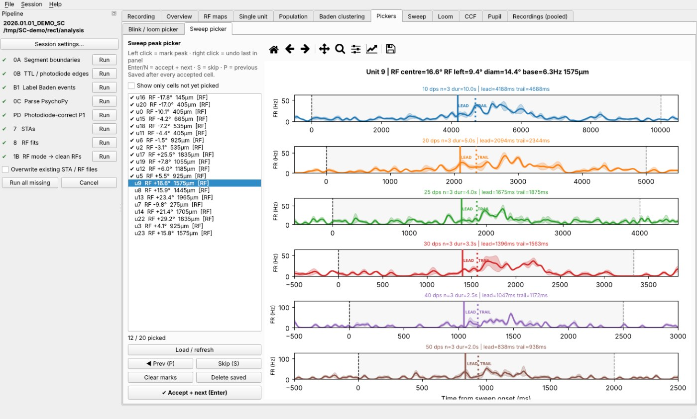
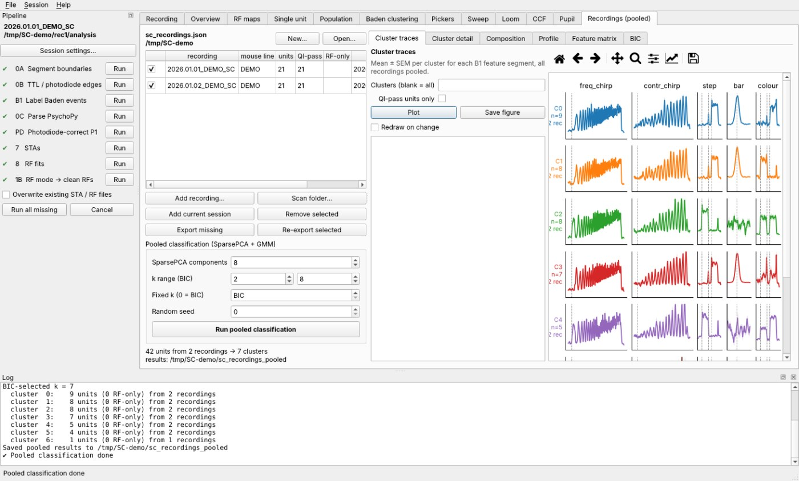

# SC Analysis



Desktop app for analysing Neuropixels recordings from the mouse superior colliculus
(SC). It turns the `SC_analysis_v24.ipynb` pipeline into a GUI: a read-only trace viewer
for the concatenated, Kilosort-sorted recording, plus every analysis from the notebook
(stimulus sync, receptive-field mapping, Baden-style functional clustering, peak pickers,
sweep / loom / CCF / pupil analyses) and classification pooled across many recordings,
run from buttons instead of cells.

## Screenshots








*Screenshots use the synthetic demo recordings built into the app's self-test.*

## Download and install

Get the installer for your computer from the
[latest release](https://github.com/jerjely/SC-Analysis/releases/latest):

| Computer | File | Notes |
|---|---|---|
| Windows 10/11 (64-bit) | `SC-Analysis-<version>-Windows-setup.exe` | Installs for your user only, no admin rights. Adds a Start menu entry and an optional desktop shortcut. |
| Mac with Apple silicon (M1–M4) | `SC-Analysis-<version>-macOS-AppleSilicon.pkg` | Installs **SC Analysis** into /Applications. |
| Mac with Intel processor | `SC-Analysis-<version>-macOS-Intel.pkg` | Installs **SC Analysis** into /Applications (also runs on Apple silicon via Rosetta). |

The installers are not code-signed, so you'll see a warning the first time:

* **Windows:** "Windows protected your PC" → **More info → Run anyway**.
* **Mac:** if the package is blocked, open **System Settings → Privacy & Security**, scroll
  down and click **Open Anyway** (or right-click the .pkg → **Open**).

**Help → About** shows the installed version.

### What is not included

The app reads the *output* of these tools. Install them separately where you need them
(they need their own drivers, GPUs or compilers, so they can't go inside the installer):

| Tool | Used for |
|---|---|
| Kilosort4 (+ Phy for curation) | spike sorting; the app reads `sorter_output/` |
| SpikeGLX / Open Ephys, CatGT | recording and concatenation; the app reads the `.meta`/OneBox files and the concatenated binary |
| PsychoPy | stimulus presentation; the app reads the CSV logs |
| DeepLabCut | pupil tracking; the app reads the `…DLC.h5` files |

## Quick start

1. **File > New session from Kilosort folder…** and pick the `sorter_output` folder.
   For the usual layout (`…\<date>_<line>_<region>_concat\ks4_output_concat\sorter_output`)
   the analysis folder (SAVE_DIR), date / mouse line / region, PsychoPy folder and
   frames file are filled in for you. Check the paths (NPX root = `D:\NPX`) and press OK.
   Settings are saved as `sc_session.json` in SAVE_DIR; reopen it with **File > Open session**.
2. **Pipeline** (left): press **Run all missing**. Steps already done (files present in
   SAVE_DIR) show a ✔, so an existing notebook analysis folder opens with everything done.
   | Notebook cell | Step |
   |---|---|
   | 0A | Segment boundaries |
   | 0B | TTL / photodiode edges (B1 photodiode override is in settings) |
   | B1 labelling | Label Baden events (trailing extra edge trimmed) |
   | 0C | Parse PsychoPy |
   | PD | Photodiode-correct P1 |
   | 7 / 8 / 1B | STAs, RF fits, RF mode → `rf_results_clean.npy` |
3. Use the tabs.

## Tabs

* **Recording** – concatenated binary (from `params.py` `dat_path`, or *Locate binary…*),
  channels coloured by shank and ordered by depth, 300 Hz high-pass + CAR, units drawn on
  their best channel, segment shading and stimulus onsets with condition names.
  Jump to a segment or to trial *n* of any condition; mouse wheel = time,
  Ctrl+wheel = gain. Unit table: click to highlight, ◀/▶ spike to step through its spikes,
  double-click to open it in *Single unit*.
* **Overview** – segment timeline + stimulus sequence (Cell 20), units, B1 vs protocol
  (cells 8-9), photodiode delays.
* **RF maps** – mode maps (1B), interactive click-a-contour STA viewer (30), depth-filtered
  maps (29), example STAs (31), STA browser RFM1 vs RFM2 (75), all STA lags, retinotopy (77),
  contours (78-79).
* **Single unit** – raster + PSTH for any condition with optional PD-corrected onsets (4),
  whole B1 sequence (4C), Baden browser (chirp / step / RF-aligned bar / colour),
  gratings G1 vs G2 (5), raw TTL vs PD-corrected comparison. ← → keys step units.
* **Population** – z-scored heatmaps for any set of conditions (3A/3B), B1 routines (3C),
  sweep heatmaps by speed with RF-edge lines (S1), grating heatmap (6).
* **Baden clustering** – QI, feature vectors, DS/OS (pooled and per-trial baselines),
  colour opponency, SparsePCA + GMM (BIC), cluster traces, profile table, export to
  `clustering_export/` for multi-session pooling.
* **Pickers** – blink/loom and sweep peak pickers (left click mark, right click undo,
  Enter accept + next, S skip, P previous). Saved after every cell to the same
  `blink_loom_picks.json/.csv` and `interactive_picks.json/.csv` files; reopening a cell
  shows its earlier picks.
* **Sweep** – latency vs depth with click-to-exclude (S2/S3, saved to
  `sweep_excluded_cids.json` + `interactive_picks_clean.csv`), depth vs arrival time (S4),
  population summary (S5), per-cell picks (S7) and *Export all cell plots* (S6).
* **Loom** – latency vs depth per condition (L1), on the RF map (L2), several conditions
  with optional hulls / RF-size bars (L3, L4, R1), bar plots (L5), response classes.
* **CCF** – compute spontaneous-segment CCFs (C1), pairs on RF maps (C2/C3), examples (C4),
  z vs distance (C5), far pairs, and any pair you choose.
* **Pupil** – align a segment's eye video to imec time (grating segments: drift-onset grid;
  P1: white blink + loom matching), per-size mean position, trial browser, raster + pupil,
  neural and OKN oscillation frequency vs grating, reset rate, slow-phase velocity / gain,
  gaze-corrected sweep PSTHs, loom pupil responses.

* **Recordings (pooled)** – the list of completed recordings and the classification across
  them (see below).

Every figure has **Save figure** (PNG + EPS into SAVE_DIR) and the matplotlib toolbar.

## Classifying across recordings

1. **Recordings (pooled) > New…** creates a recording list (e.g. `Downloads\neuropixel\sc_recordings.json`).
2. Add recordings with **Scan folder…** (finds every analysis folder with `sc_session.json` or
   `clustering_export/`), **Add recording…** or **Add current session**. Tick the ones to include.
3. **Export missing** runs QI → features → DS/OS → colour → export for every included recording
   that has no `clustering_export` yet (its pipeline must be finished). Recordings exported by
   the old notebook cell still pool; *Re-export selected* adds the colour and speed fields.
4. **Run pooled classification**: SparsePCA + GMM fitted on the pooled QI-pass units (BIC
   picks k, or set a fixed k); RF-only units are assigned with the same model. Clusters are
   numbered by size.
5. Results go to `<list name>_pooled/` (`pooled_units.csv`, `pooled_meta.json`, …) and each
   recording gets `clustering_export/pooled_cluster_labels.csv`.

The same recording listed twice (same date / line / region) is only used once.

## Notes

* All files are read and written with the notebook's names and formats, so the GUI and
  the notebook can be used on the same folder.
* STA, DS/OS / colour permutation tests and CCFs are vectorised; results are identical to
  the notebook loops (same seeds, same shuffles), just faster.
* Hard-coded values from the notebook (screen geometry, B1 protocol, OBX channels, PD
  parameters, QI threshold, sign flips, picker conditions, pupil crop / camera offset…)
  are all in **Session settings**.

## Install from source (development)

Needs Python 3.10 or newer (3.11 or 3.12 recommended).

* **Windows:** double-click `Install.bat`. It finds Miniconda/Anaconda, creates a
  `sc_analysis` environment (Python 3.11), installs everything and puts an
  **SC Analysis** shortcut on the desktop. If something fails at start-up, run
  `%LOCALAPPDATA%\SCAnalysis\SC Analysis (console).bat` to see the error.
* **macOS:** double-click `Install.command` (right-click → Open the first time).
* **Any system, by hand:**

  ```bash
  python -m venv .venv && source .venv/bin/activate     # Windows: .venv\Scripts\activate
  pip install -r requirements.txt
  pip install -e .
  sc-analysis                # or: python -m sc_analysis
  ```

### Self-test

```bash
python -m sc_analysis --selftest report.txt          # from source
SC-Analysis --selftest report.txt                     # a built app
```

It writes two small synthetic recordings to a temporary folder, runs the whole pipeline,
opens the main window off-screen, draws every analysis panel, drives both pickers, loads
the trace viewer and runs the pooled classification. Exit code 0 means everything worked
(takes about 2–3 minutes). Add `--keep DIR` to keep the demo recordings, e.g. to try the app
without real data.

### Building the app locally

```bash
pip install -r requirements.txt "pyinstaller>=6.10"
python install/ci_version.py 1.2.0          # optional: stamp a version
python -m PyInstaller --noconfirm --distpath dist --workpath build install/sc_analysis.spec
```

This gives `dist/SC-Analysis/` (Windows/Linux) or `dist/SC Analysis.app` (macOS).
`install/windows_installer.iss` (Inno Setup) and `install/make_pkg.sh` wrap them into the
installers.

## Making a release

GitHub builds the installers itself (`.github/workflows/build-installers.yml`) on Windows,
Apple-silicon Mac (`macos-15`) and Intel Mac (`macos-15-intel`). Each build self-tests the
packaged app before the installer is made, so a broken build is never released.

Either:

* **Tag:** in GitHub Desktop, *History* → right-click the commit → *Create Tag…* →
  `v1.2.0` → *Push origin*; or
* **Button:** on github.com, *Actions → Build installers → Run workflow*, type `1.2.0` in
  the **version** box. The release and the tag `v1.2.0` are created for you.

Leave the version box empty to only build and test (the installers are kept as workflow
artifacts for 7 days, no release). The version from the tag is written into the app
(Help → About) and into the file names. After ~15–20 minutes the release with the three
installers appears under **Releases**.

## Licence

MIT, see [LICENSE](LICENSE). © 2026 Gergely Szarka.
